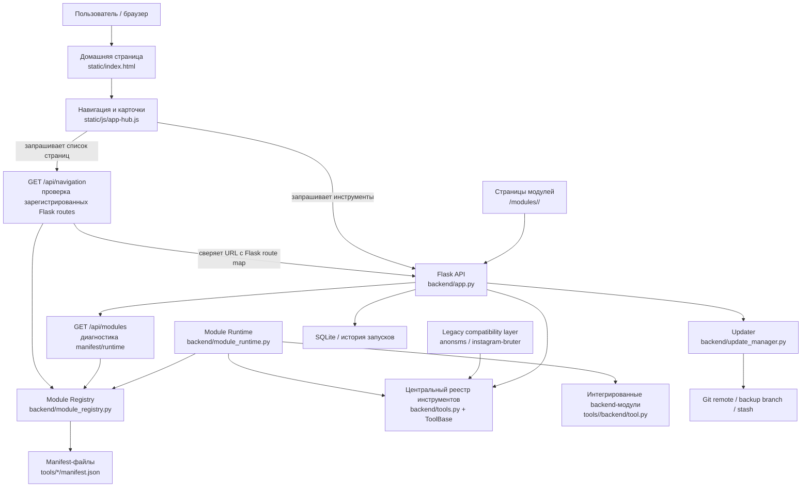
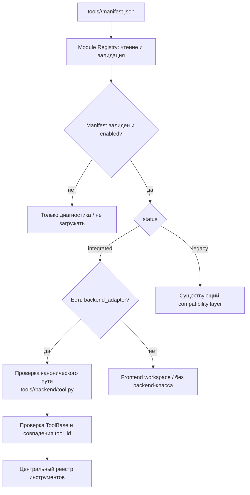
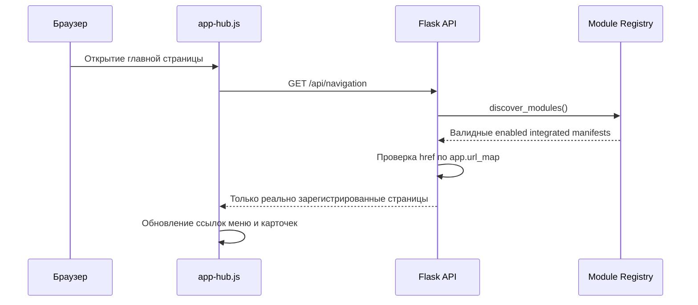

# Архитектурный граф OSINT Panel 4.2

Документ показывает фактическую структуру текущей ветки, а не желаемую конечную архитектуру. Он нужен для планирования следующих этапов миграции и поиска точек, где ещё сохраняется legacy-совместимость.

## 1. Общая архитектура

## 2. Поток загрузки модулей

## 3. Поток домашней навигации

## 4. Где находятся компоненты сейчас

| Область | Текущий владелец | Состояние |
|---|---|---|
| Manifest и discovery | `tools/*/manifest.json`, `backend/module_registry.py` | Работает |
| Backend runtime | `backend/module_runtime.py` | Загружает интегрированные backend-модули по каноническому пути |
| Центральный API и Flask routes | `backend/app.py` | Работает, содержит compatibility routes |
| Домашняя навигация | `static/js/app-hub.js` | Получает manifest-driven список через `/api/navigation` |
| UI и общие стили | `static/` | Частично общие, ещё не вынесены в `core/` |
| История | `backend/` + SQLite | Работает через API |
| Обновление | `backend/update_manager.py`, `static/js/settings.js` | Единая кнопка, job status и прогресс |
| Vendor-проекты | `tools/<id>/` | Остаются внутри своих каталогов; переносить механически нельзя |

## 5. Важные границы

- Manifest — декларативные данные; он не должен исполнять произвольные пути.
- Backend runtime загружает только интегрированные backend-адаптеры из `tools/<id>/backend/tool.py`.
- Наличие frontend-файла само по себе не означает, что страница доступна: ссылка попадает в навигацию только при наличии соответствующего Flask route.
- Два legacy-модуля не переводятся в integrated автоматически: для них нужна отдельная проверка поведения и рисков.
- Каталог `core/` пока не является фактическим общим ядром проекта. Его создание отложено до выделения стабильных контрактов и тестов.
- GrabCam остаётся consent-based: никакой скрытой съёмки, скрытого доступа к файлам или скрытого сбора геолокации.

## 6. Следующие этапы по графу

1. Завершить аудит соответствия всех manifest-полей реальным Flask routes и frontend-файлам.
2. Перевести повторяющиеся compatibility routes на единый безопасный route helper, не меняя публичные URL.
3. Выделить стабильные общие контракты UI/API до создания `core/`.
4. Свести управление зависимостями к единому dependency manager; не запускать установку зависимостей из каждого модуля автоматически.
5. Добавлять регрессионные тесты для каждого маршрута до удаления старых копий.
